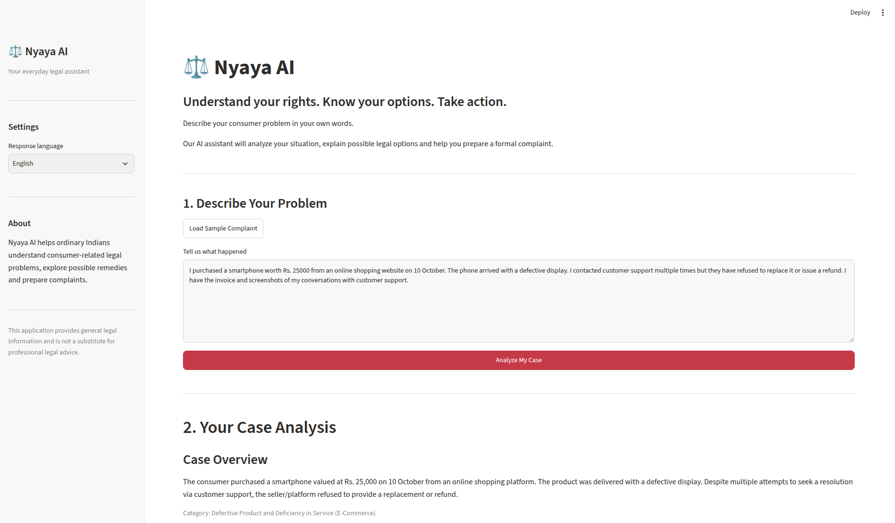
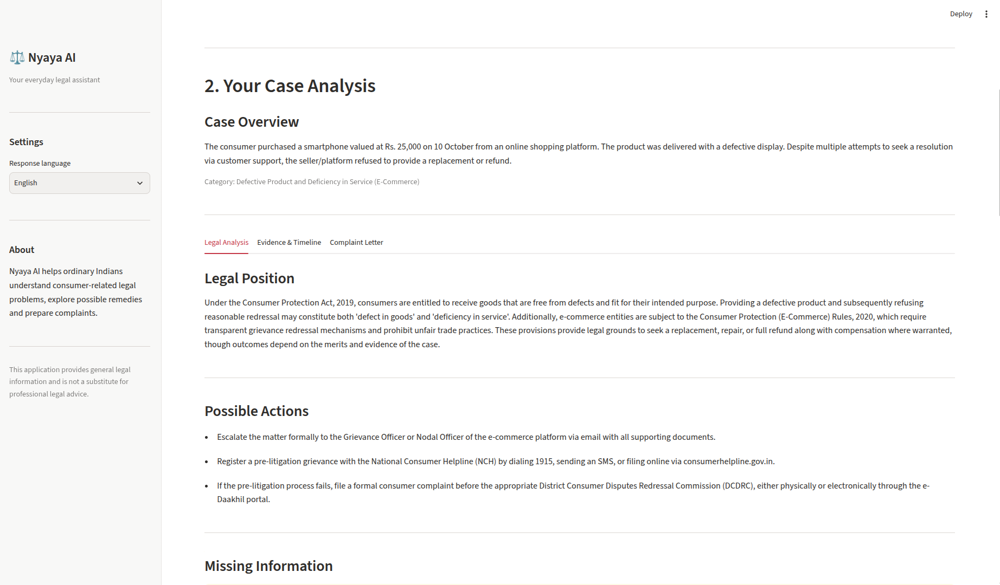
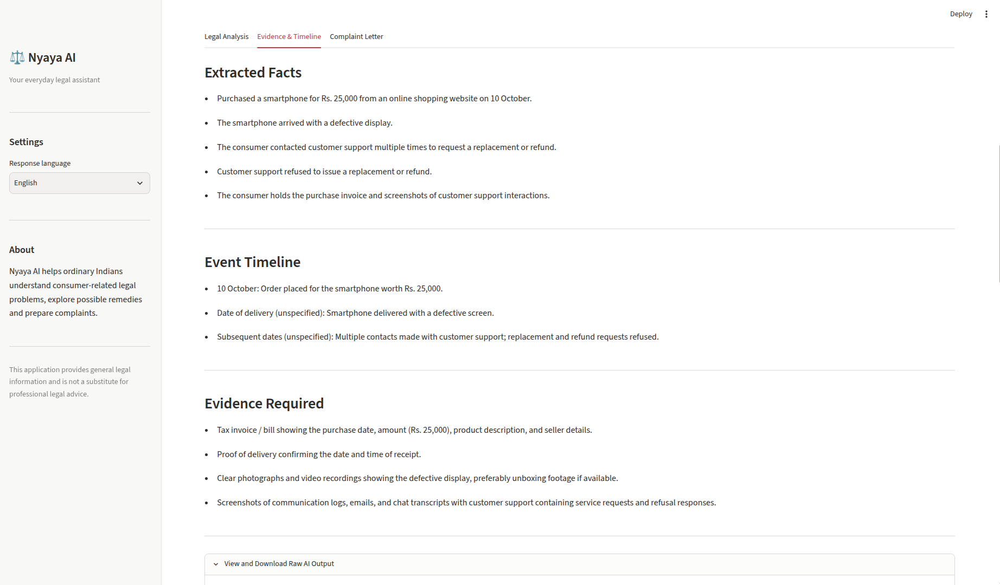
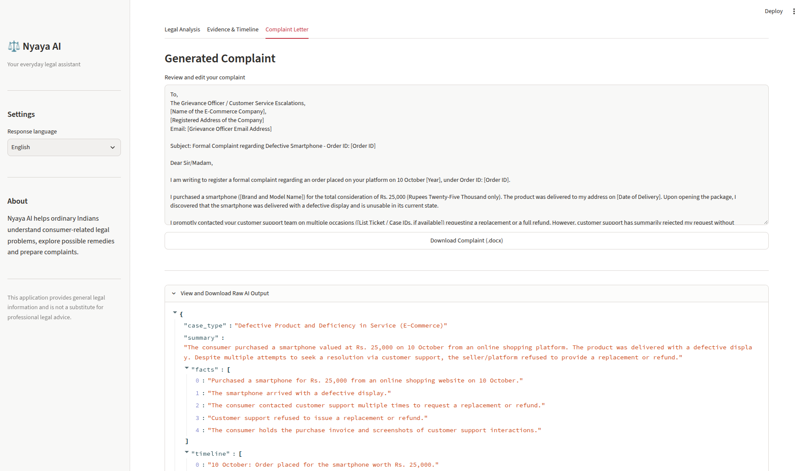
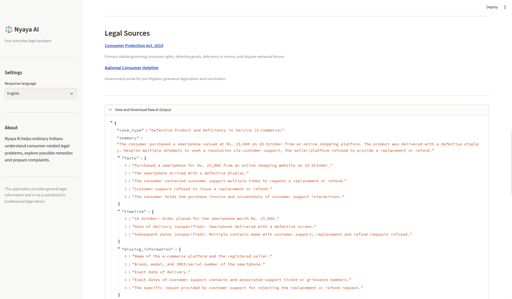
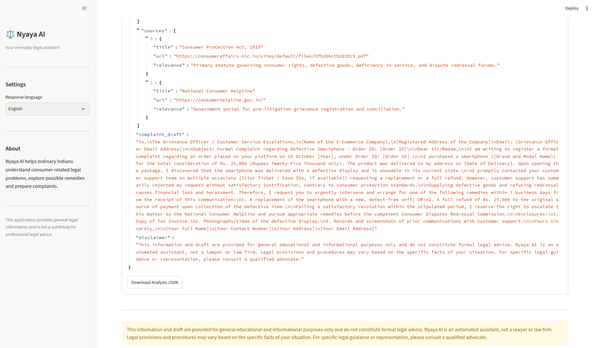
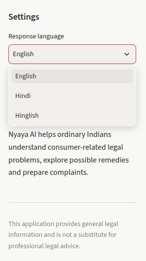

# ⚖️ Nyaya AI — Consumer Rights Assistant

**Understand your rights. Know your options. Take action.**

Nyaya AI is an AI-powered consumer rights assistant designed to help ordinary people in India understand consumer-related legal problems, explore possible remedies, and prepare formal complaints.

Users can describe their problems in natural language and receive a structured analysis containing relevant facts, possible legal options, missing information, evidence requirements and a professionally drafted complaint.

## Live Deployment

The project, **Nyaya AI – Consumer Rights Assistant**, is live and accessible at the following link:

[**https://nyaya-ai-hrshta.streamlit.app/**](https://nyaya-ai-hrshta.streamlit.app/)

## Application Screenshots

### Home Page


### AI-Powered Legal Analysis


### Evidence & Timeline


### Complaint Letter


### Legal Sources


### View & Download Raw AI Output


### Multilingual Support


## Features

### 1. AI-Powered Complaint Analysis
- Accepts consumer complaints in natural language.
- Identifies the type of consumer grievance.
- Extracts relevant facts, dates, amounts and parties.
- Generates a structured case summary.

### 2. Legal Guidance
- Explains possible consumer rights in simple language.
- Suggests practical actions and potential remedies.
- Identifies missing information required for better assessment.
- Provides references to relevant legal and government resources.

### 3. Evidence and Timeline Extraction
- Extracts important facts from the complaint.
- Organizes events into a chronological timeline.
- Identifies supporting documents and evidence that may be required.

### 4. Complaint Document Generation
- Generates professionally structured complaint letters.
- Allows users to review and edit generated content.
- Supports downloading complaints in Microsoft Word format.

### 5. Multilingual Support
Users can request responses in:
- English
- Hindi
- Hinglish

## Technology Stack

| Component | Technology |
|---|---|
| Frontend | Streamlit |
| Backend | Python |
| AI Model | Google Gemini 3.8 Flash |
| AI Integration | Google GenAI SDK |
| Document Generation | python-docx |
| Configuration | python-dotenv |

## Application Architecture

The application follows a modular request-response architecture.

1. The user submits a description of their consumer grievance.
2. The frontend passes the description and preferred language to the AI engine.
3. The AI engine constructs a prompt using predefined instructions and sends it to Gemini.
4. Gemini returns structured JSON containing the case summary, extracted facts, legal position, possible actions, missing information, evidence requirements and complaint draft.
5. The frontend renders the response in separate sections.
6. The document generator converts the complaint draft into a downloadable Word document.

## Project Structure

```text
nyaya/
│
├── app.py
├── ai_engine.py
├── prompts.py
├── document.py
│
├── requirements.txt
├── README.md
├── .gitignore
├── .env
│
└── test_results/
    └── test_inputs.md
```

## Installation and Setup

### Prerequisites

- Python 3.10 or later
- Google Gemini API key

### 1. Clone the repository

```bash
git clone https://github.com/harshita852/Nyaya-AI.git
cd nyaya
```

### 2. Create a virtual environment

```bash
python3 -m venv venv
source venv/bin/activate
```

### 3. Install dependencies

```bash
pip install -r requirements.txt
```

### 4. Configure environment variables

Create a `.env` file in the project root:

```env
GEMINI_API_KEY=your_api_key_here
GEMINI_MODEL=gemini-3.8-flash
```

Obtain an API key from [Google AI Studio](https://aistudio.google.com/apikey).

### 5. Run the application

```bash
streamlit run app.py
```

The application will be available at:

`http://localhost:8501`

## Legal Reliability and Safety

Legal accuracy is particularly important because incorrect legal information can mislead users.

Nyaya AI incorporates the following safeguards:

- **Structured responses:** The model is instructed to return information using a predefined JSON structure.
- **No fabricated provisions:** The system explicitly instructs the model not to invent statutory sections, court judgments or legal citations.
- **Explicit uncertainty:** Uncertain legal interpretations should be identified rather than presented as established facts.
- **Missing information detection:** The application identifies incomplete information instead of making unsupported assumptions.
- **Source references:** The model is instructed to prefer official government resources.
- **Human verification:** Users are advised to verify important legal information and consult qualified lawyers when necessary.
- **API resilience:** Temporary API availability and rate-limit errors are handled through retry logic.

### Official Legal References

- [Consumer Protection Act, 2019](https://consumeraffairs.nic.in/sites/default/files/CP%20Act%202019.pdf)
- [National Consumer Helpline](https://consumerhelpline.gov.in/)

**Current implementation limitation:** The prototype uses prompt-based legal guidance and does not independently retrieve or verify statutory provisions. Generated legal citations and source links must be independently checked.

## Testing

The application is designed to be evaluated using five consumer grievance scenarios.

| Test Case | Scenario | Expected Behaviour |
|---|---|---|
| 1 | Defective product | Identify grievance, evidence and possible remedies. |
| 2 | Refund not issued | Identify refund dispute and escalation options. |
| 3 | Service not delivered | Identify service-related grievance and possible remedies. |
| 4 | Incomplete complaint | Identify missing information and request clarification. |
| 5 | Hallucination resistance | Refuse to invent or validate a nonexistent legal provision. |

Test descriptions are maintained in `test_results/test_inputs.md`.

Raw model outputs should be saved as JSON files alongside the test descriptions for evaluation.

## Limitations

- Currently focused on consumer-related grievances.
- Legal analysis depends on the quality of user input and model responses.
- Does not independently verify generated legal citations.
- Does not provide legal representation.
- Does not automatically file complaints on behalf of users.
- Generated documents require review before submission.

## Future Improvements

- Retrieval-augmented generation using verified Indian legislation and official legal resources.
- Support for tenancy, employment and other everyday legal problems.
- Document and invoice uploads for evidence extraction.
- Voice-based complaint submission.
- Persistent case history.
- Integration with the National Consumer Helpline.
- Expanded multilingual support.

## Disclaimer

Nyaya AI is an experimental AI-powered legal information assistant. It does not provide professional legal advice, create an advocate-client relationship or guarantee any legal outcome.

Users should independently verify legal information and consult qualified legal professionals when necessary.

---

**Built as part of the Kuku AI Generalist Assignment.**